<p align="center">
  
</p>

<p align="center">
  <a href="#quick-start"><b>Quick start</b></a>
  &nbsp;·&nbsp;
  <a href="#how-it-works"><b>How it works</b></a>
  &nbsp;·&nbsp;
  <a href="#what-you-get"><b>What you get</b></a>
  &nbsp;·&nbsp;
  <a href="#built-for-ai-agents"><b>AI agents</b></a>
  &nbsp;·&nbsp;
  <a href="#built-for-software-factories"><b>Software factories</b></a>
  &nbsp;·&nbsp;
  <a href="docs/spec/SPEC.md"><b>Spec</b></a>
</p>

<p align="center">
  <a href="go.mod"></a>
  <a href="LICENSE"></a>
  
  
  
</p>

**Scenery is a runtime, toolchain, and agent harness for Go, Rust, and JavaScript/TypeScript backends.**
Describe *what your app is* (APIs, durable jobs, data, auth, schedules) in small
`.scn` files and write *what it does* in plain Go. Scenery generates the typed
contracts and TypeScript clients, runs the whole app and its frontends with one
command, and exposes machine-readable state and telemetry for humans and AI
agents.

## How it works

<p align="center">
  
</p>

**1. Declare what exists** in [`testdata/apps/basic/service/package.scn`](testdata/apps/basic/service/package.scn):

```hcl
operation "echo" {
  service = service.service
  input   = record.echo_input
  handler { method = "Echo" }
  result "ok" { type = record.echo_result }
}

binding "echo_http" {
  operation = operation.echo
  protocol  = "http"
  http { method = "POST"; path = "/echo" }
}
```

**2. Write the handler in Go** against the generated `scenerycontract` package:

```go
func (*Service) Echo(_ context.Context, in contract.EchoInput) (contract.EchoOutcome, error) {
	return contract.EchoOk{Value: contract.EchoResult{Message: "echo:" + in.Message}}, nil
}
```

**3. Run the whole app** with `scenery up`:

```sh
scenery up
curl --json '{"message":"hi"}' http://localhost:4624/api/echo
# {"message":"echo:hi"}
```

## What you get

- **Typed HTTP APIs** — declared records, validated input, typed outcomes, and neutral end-user surfaces.
- **Durable jobs, schedules & events** — retries, timeouts, leases, and idempotency keys declared next to operations.
- **Managed PostgreSQL & object storage** — Docker Postgres per worktree, checksummed migrations (`scenery db migrate`), snapshots, and tenant-scoped `scenery.sh/storage`.
- **Built-in auth & connections** — sessions, organizations, invites, and encrypted OAuth2/OIDC user connections.
- **Generated TypeScript client** — exact wire types (`bigint`, `decimal`, optional/nullable) plus optional React pages.
- **First-class telemetry** — logs, traces, and metrics queryable as JSON via `scenery logs`, `traces`, and `metrics`.
- **Process-per-service live rebuilds** — edits rebuild and swap only touched services while unaffected services keep serving.

## One command, the whole app

<p align="center">
  
</p>

| Command | Purpose |
|---|---|
| `scenery up` | Build, start, and watch the app, database, and frontends |
| `scenery ps` | List running apps and URLs |
| `scenery context --for <target> -o json` | Read a module briefing by module, service, route, or source file |
| `scenery test [<module>...] -o json` | Refresh contracts and run native module tests |
| `scenery call <target> -o json` | Invoke the current local runtime and retrieve its logs and spans |
| `scenery db query --service <module> '<sql>' -o json` | Run one statement in the module's PostgreSQL schema, bind repeatable `--param` values, and cap returned rows with `--limit` |
| `scenery durable run <target> -o json` | Run a durable execution or schedule in the worker development Host and collect its result, logs, and spans. Use `--wait=false` to return after dispatch |
| `scenery add module <name> --runtime <go\|rust\|ts\|js> -o json` | Scaffold a module and starter test, generate contracts, and check the application |
| `scenery logs --follow` | Stream application logs |
| `scenery check` | Validate `.scn` declarations and Go contracts |
| `scenery generate` | Regenerate Go contracts, TypeScript clients, and SQLC outputs |
| `scenery down` | Stop the app |
| `scenery doctor` | Verify host and app prerequisites |

Discover exact command grammar with `scenery help <command> -o json`.
`scenery ps --wait -o json` waits for the captured source revision and reports
compiler failures as soon as the supervisor records them.

`durable run` accepts a qualified operation or execution name, a durable
`external_name`, or a schedule name. JSON uses `execution_kind` for the
declared target type. Direct schedules run in the current Host generation.

`add module` reports the generated roots and the application check outcome.
If generation or checking fails, the scaffold stays available for correction.

## Built for AI agents

Every command supports `-o json` (or `-o jsonl` for streams) with exact schema
revisions, producer identity, and stable `SCNxxxx` diagnostics:

```sh
scenery inspect app -o json
scenery inspect routes -o json
scenery check -o json
scenery logs -o jsonl --limit 200
scenery traces list --status error -o json
scenery validate changed --base main -o json
scenery harness -o json --write
```

Install the agent skill ([SKILL.md](SKILL.md)):

```sh
npx skills add https://github.com/scenery-sh/scenery
```

## Built for software factories

<p align="center">
  
</p>

Each Git worktree runs a fully isolated copy of the app with its own URL,
PostgreSQL database, object storage, and telemetry:

```sh
scenery worktree create new-checkout
cd ../myapp-new-checkout
scenery up --detach
scenery ps
```

## Quick start

Requires **Go 1.27+** (and **Docker** for managed PostgreSQL).

```sh
git clone https://github.com/scenery-sh/scenery.git
cd scenery
go install ./cmd/scenery
scenery doctor
```

Explore [examples/webhook-inbox/README.md](examples/webhook-inbox/README.md),
or read [docs/spec/SPEC.md](docs/spec/SPEC.md),
[ARCHITECTURE.md](ARCHITECTURE.md), and [CONTRIBUTING.md](CONTRIBUTING.md).

Report vulnerabilities privately via [SECURITY.md](SECURITY.md).
Licensed under [Apache 2.0](LICENSE).

<p align="center">
  
</p>
