<p align="center">
  
</p>

<p align="center">
  <a href="#architecture"><b>Architecture</b></a>
  &nbsp;·&nbsp;
  <a href="#how-it-works"><b>How it works</b></a>
  &nbsp;·&nbsp;
  <a href="#what-you-get"><b>What you get</b></a>
  &nbsp;·&nbsp;
  <a href="#deploy"><b>Deploy</b></a>
  &nbsp;·&nbsp;
  <a href="#built-for-ai-agents"><b>AI agents</b></a>
  &nbsp;·&nbsp;
  <a href="#built-for-software-factories"><b>Software factories</b></a>
  &nbsp;·&nbsp;
  <a href="docs/spec/SPEC.md"><b>Spec</b></a>
</p>

<p align="center">
  
  <a href="LICENSE"></a>
  
  
  
</p>

**Scenery is a polyglot application microkernel, toolchain, and agent harness.**
Describe *what your app is* (APIs, durable jobs, domain events, data, auth,
schedules) in small `.scn` files and write *what it does* in **Go, Rust,
TypeScript/JavaScript, or Python**. One Rust application host (`scenery-kernel`)
owns public ingress, auth, policy, durable execution, events, storage, and
telemetry, while your services run underneath as long-lived, contract-attested
native workers.

## Architecture

Scenery is **not** a VM hypervisor and **not** a cold-start FaaS/Lambda
runtime. It is an **application host** with a strict capability boundary:

```text
                       .scn + .scenery.json
                                │
                                ▼
       ┌────────────────────────────────────────────────────────┐
       │           scenery-kernel (Rust application host)       │
       │  • Same-origin ingress: /api/* → services, / → Vite    │
       │  • Contract codecs, validation, SSE, OpenAPI 3.1.1     │
       │  • Auth, sessions, OIDC, secrets, policy evaluation    │
       │  • Durable jobs, schedules, transactional event bus    │
       │  • Storage (local / S3), OTLP telemetry, MCP           │
       └──────┬─────────────┬─────────────┬─────────────┬───────┘
              │  Worker ABI v1 (HTTP/2 over private Unix sockets)
      ┌───────▼──┐   ┌──────▼───┐   ┌─────▼────┐   ┌────▼─────┐
      │    Go    │   │   Rust   │   │ TS / JS  │   │  Python  │
      │  worker  │   │  worker  │   │  (Bun)   │   │   (uv)   │
      └───────┬──┘   └──────────┘   └─────┬────┘   └────┬─────┘
              └────────────────────┬──────┴─────────────┘
                           native PostgreSQL
```

- **Capability boundary, not a VM sandbox** — `scenery-kernel` keeps
  `Authorization`, `Cookie`, secrets, and policy enforcement at the host
  boundary. Workers authenticate over private Unix domain sockets with
  per-instance bearer tokens and opaque `X-Worker-Scope` headers; they cannot
  forge principals, tenants, or generations and reach other services, storage,
  events, and OAuth tokens only through scoped `/host/v1/*` capabilities (see
  [Worker ABI v1](docs/spec/WORKER-ABI.md)).
- **Long-lived native workers, not cold-start functions** — Each service runs
  as a warm OS process—Go, JS/TS, and Python workers open native PostgreSQL
  pools (`pgx`, etc.; Rust SQL supply is planned)—supports
  binary streaming and typed SSE (`stream_out`), and hot-swaps independently
  with graceful drain when code changes.
- **Same topology in dev and production** — Local `scenery up` and production
  `scenery build` / `--oci` bundles run the same manifest-driven
  `scenery-kernel` + worker topology (with Vite HMR proxied in dev and static
  frontend assets served directly by `scenery-kernel` in production).

## How it works

<p align="center">
  
</p>

**1. Declare what exists** in `package.scn` (one canonical graph for every language;
abridged—see [`testdata/apps/polyglot/pricing/package.scn`](testdata/apps/polyglot/pricing/package.scn)
for the complete declaration):

```hcl
service "pricing" {
  runtime = "rust" # or "go", "ts", "js", "python"
  implementation { constructor = "NewService" }
}

operation "quote" {
  service = service.pricing
  input   = record.quote_input
  handler { method = "Quote" }
  result "ok" { type = record.quote_result }
}

binding "quote_http" {
  operation = operation.quote
  protocol  = "http"
  http {
    method = "POST"
    path   = "/quote"
  }
}
```

**2. Implement the service** in the language that fits each module against its
generated `scenerycontract` (see [`testdata/apps/polyglot`](testdata/apps/polyglot)
for a full Go + Rust + TypeScript + Python + React app):

```go
// Go worker
func (*Service) Quote(_ context.Context, in contract.QuoteInput) (contract.QuoteOutcome, error) {
	return contract.QuoteOk{Value: contract.QuoteResult{Amount: in.Amount}}, nil
}
```

```rust
// Rust worker
impl PricingService for Service {
    async fn quote(&self, _ctx: sdk::Context, input: QuoteInput) -> sdk::Result<QuoteOutcome> {
        Ok(QuoteOutcome::Ok(QuoteResult { amount: input.amount }))
    }
}
```

Scaffold a new module in any supported runtime with one command:

```sh
scenery add module billing --runtime rust -o json
# --runtime go | rust | ts | js | python
```

**3. Run the whole app** with `scenery up`:

```sh
scenery up
curl --json '{"amount":"42"}' http://localhost:4624/api/quote
```

## What you get

- **Polyglot services in one bundle** — Mix Go, Rust, JS/TS (Bun), and Python
  (`uv` zipapp) services behind one `.scn` contract. Swapping a service's
  runtime preserves its contract revision.
- **Typed HTTP, streaming & OpenAPI 3.1.1** — Declared records, exact wire
  codecs (`bigint`, `decimal`, `optional`/`nullable`), binary streams, typed
  SSE (`stream_out`), neutral end-user HTTP surfaces, and deterministic
  brand-neutral OpenAPI 3.1.1 export.
- **Durable jobs, schedules & domain events** — Transactional PostgreSQL domain
  event bus (`event` / `publisher` / `subscription`) with durable fan-out
  across languages, retries, timeouts, leases, revisioned inputs, and
  idempotency keys.
- **Managed PostgreSQL & S3-compatible storage** — Docker Postgres per
  worktree, checksummed migrations (`scenery db migrate`), PostgreSQL template
  branching for fast isolated tests, snapshots, and tenant-scoped local or
  S3/R2/MinIO/GCS object storage.
- **Built-in auth, connections & MCP** — Sessions, organizations, invites,
  encrypted OAuth2/OIDC user connections, and provider-neutral MCP servers &
  supervised assistants.
- **Same-origin frontends & TypeScript clients** — Vite dev proxy with HMR,
  static production asset serving from `scenery-kernel`, exact TypeScript `fetch`
  clients, and optional React pages (`@scenery/ui`).
- **First-class telemetry** — Local logs, traces, and metrics queryable as JSON
  via `scenery logs`, `traces`, and `metrics`, plus production OTLP/HTTP export.
- **Per-worker live rebuilds** — Edits rebuild and hot-swap only touched
  workers with generation pinning and graceful drain while unaffected workers
  keep serving.

## One command, the whole app

<p align="center">
  
</p>

| Command | Purpose |
|---|---|
| `scenery up` | Build, start, and watch `scenery-kernel`, workers, Postgres, and frontends |
| `scenery ps` | List running apps and URLs (`--wait -o json` waits for the current source revision) |
| `scenery context --for <target> -o json` | Read a structured briefing by module, service, route, or source file |
| `scenery test [<module>...] [--branch-db] [--with-host] -o json` | Refresh contracts and run native module tests (add `--branch-db` or `--with-host` for PostgreSQL template branching) |
| `scenery call <target> -o json` | Invoke the current local runtime and return its result, logs, and spans |
| `scenery replay <token> [--emit-test] -o json` | Deterministically replay an `SCN9xxx` failure report and optionally emit a regression test |
| `scenery db query --service <module> '<sql>' -o json` | Run one parameterized statement in the module's PostgreSQL schema (`--param`, `--limit`, `--timeout`) |
| `scenery durable run <target> -o json` | Run a durable execution or schedule in the dev Host and collect its result, logs, and spans (`--wait=false` for async dispatch) |
| `scenery add module <name> --runtime <go\|rust\|ts\|js\|python> -o json` | Scaffold a module and starter test, generate contracts, and check the app |
| `scenery build [--oci <image>]` | Build a self-contained Host bundle or a distroless Linux OCI container image |
| `scenery openapi` | Emit a brand-neutral OpenAPI 3.1.1 document for declared HTTP gateways |
| `scenery logs --follow` | Stream application logs |
| `scenery check` | Validate `.scn` declarations and worker contracts across runtimes |
| `scenery generate` | Regenerate worker contracts, TypeScript clients, OpenAPI, and SQLC outputs |
| `scenery down` | Stop the app |
| `scenery doctor` | Verify host and app prerequisites |

Discover exact command grammar with `scenery help <command> -o json`.

## Deploy

`scenery build` writes a self-contained bundle that runs on any host of the
same platform; `scenery build --oci <image>` builds a distroless Linux image
(`gcr.io/distroless/cc-debian12`) for Docker, Kubernetes, Fly, or a VM
(`--platform linux/amd64|linux/arm64`, or `--oci-context <dir>` to hand the
reproducible Dockerfile context to CI):

```sh
scenery build --oci registry.example.com/shop:1.4.0
docker run -p 4000:4000 \
  -v ./config.json:/etc/shop/config.json:ro -e SCENERY_CONFIG_FILE=/etc/shop/config.json \
  -e STRIPE_KEY -e DATABASE_URL \
  -e OTEL_EXPORTER_OTLP_ENDPOINT=https://otel.example.com \
  -e OTEL_EXPORTER_OTLP_HEADERS="Authorization=Bearer%20$OTEL_TOKEN" \
  registry.example.com/shop:1.4.0
```

Configuration snapshots reference injected secrets as `{"$env": "STRIPE_KEY"}`;
object stores support local disks or S3, R2, MinIO, and GCS buckets (SigV4);
and replicas sharing `DATABASE_URL` claim schedule slots in PostgreSQL so each
slot runs once. See [the production host contract](docs/spec/SPEC.md#8-production-host).

## Built for AI agents

Every command supports `-o json` (or `-o jsonl` for streams) with exact schema
revisions, producer identity, and stable `SCNxxxx` diagnostics. Agents can read
module context, call live endpoints or durable jobs with inline traces, query
module schemas, and verify changes without scraping unstructured logs:

```sh
scenery context --for <module> -o json
scenery inspect routes -o json
scenery check -o json
scenery call <target> -o json
scenery replay <report-token> --emit-test -o json
scenery durable run <target> -o json
scenery test -o json
scenery traces list --status error -o json
scenery validate changed --base main -o json
scenery harness -o json --write
```

Install the agent skill ([SKILL.md](SKILL.md)):

```sh
npx skills add https://github.com/scenery-sh/scenery
```

## Built for software factories

<p align="center">
  
</p>

Each Git worktree runs a fully isolated copy of the app with its own URL,
PostgreSQL database, object storage, and telemetry — letting multiple agents or
branches run and verify in parallel on one machine:

```sh
scenery worktree create new-checkout
cd ../myapp-new-checkout
scenery up --detach
scenery ps
```

## Quick start

Building and running Scenery from source requires **Go 1.27+** and **Rust via
`rustup` with toolchain `1.99.1`** (every app builds the `scenery-kernel` host
on first run), plus **Docker** for managed PostgreSQL and **Bun** / **`uv`**
for JS/TS or Python services.

```sh
git clone https://github.com/scenery-sh/scenery.git
cd scenery
go install ./cmd/scenery
scenery doctor
```

Explore [examples/shortlink/README.md](examples/shortlink/README.md),
[examples/webhook-inbox/README.md](examples/webhook-inbox/README.md), and
[testdata/apps/polyglot](testdata/apps/polyglot), or read
[docs/spec/SPEC.md](docs/spec/SPEC.md),
[docs/spec/WORKER-ABI.md](docs/spec/WORKER-ABI.md),
[ARCHITECTURE.md](ARCHITECTURE.md), and [CONTRIBUTING.md](CONTRIBUTING.md).

Report vulnerabilities privately via [SECURITY.md](SECURITY.md).
Licensed under [Apache 2.0](LICENSE).

<p align="center">
  
</p>
